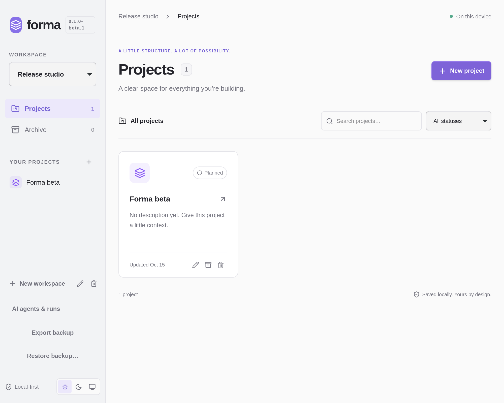
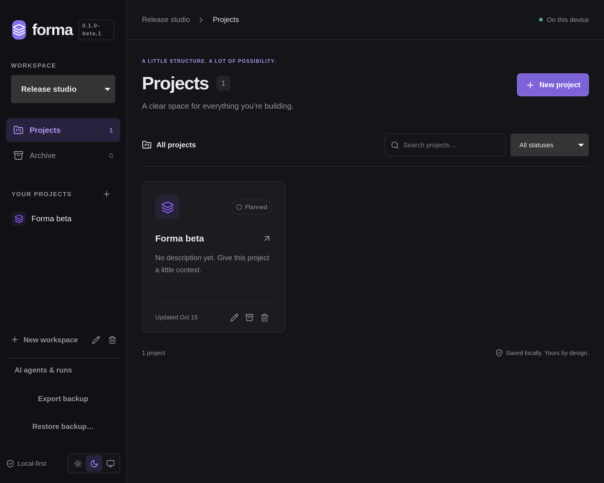

# Forma

A local-first desktop project manager for developers. Fast, quiet, and yours.

Proposed first public beta: **0.1.0-beta.1** (unpublished). Forma keeps work in
Rust-owned SQLite on your computer; no Forma account or server is required.

- Workspaces, projects, issues, subtasks, labels, activity and combined filters.
- List and Kanban views with keyboard navigation and persistent ordering.
- Native Git repository connection, branch/commit inspection and issue links.
- Opt-in approved Codex/Claude runs, explicit task queues, independent tests and
  retained-worktree review/cleanup. No automatic commits, merges or pushes.
- Native consistent backup/restore, recovery snapshots and light/dark/system mode.

Targets: Linux x86_64 (AppImage/DEB), Windows x64 (NSIS/MSI), Intel macOS and
Apple Silicon macOS (separate DMGs). See [installation](docs/INSTALLATION.md),
[troubleshooting](docs/TROUBLESHOOTING.md), [changelog](CHANGELOG.md) and the
[release candidate evidence](M07.md) for actual verification and download status.
Unsigned Windows/ad-hoc macOS candidates are not trusted public packages;
signing, notarization and clean-machine QA remain release gates.

Git worktrees are **not OS security sandboxes**. Providers/test runners execute
as your OS user and require explicit authorization. Backups are unencrypted and
log redaction is incomplete. Read the [security model](docs/SECURITY-MODEL.md)
before enabling agents. Local-first Forma does not make provider inference offline.

## Screenshots

Genuine Linux desktop captures of this beta with an isolated sample workspace.

| Light                                                                | Dark                                                               |
| -------------------------------------------------------------------- | ------------------------------------------------------------------ |
|  |  |

Download the unpublished [six-installer candidate](https://github.com/foti-antonio/forma/actions/runs/38812171147/artifacts/12009217865)
and verify its [SHA-256 checksums](docs/releases/v0.1.0-beta.1.SHA256SUMS).
See [M07](M07.md) for the exact source and remaining distribution gates.

## Develop

Install Git, **Node.js 24 LTS**, **pnpm 11.3.0**, and Rust 1.90 or newer (current stable recommended) through
[rustup](https://rustup.rs). Enable pnpm through Corepack if available, or install
it with `npm install -g pnpm@11.3.0`.

### Linux

On Ubuntu 24.04 / Debian with WebKitGTK 4.1 packages:

```sh
sudo apt-get update
sudo apt-get install build-essential curl file libssl-dev libwebkit2gtk-4.1-dev libappindicator3-dev librsvg2-dev patchelf xdg-utils
```

On Arch Linux: `sudo pacman -S --needed base-devel webkit2gtk-4.1 openssl curl wget file librsvg patchelf`.

Use a graphical desktop session. AppImage execution may additionally require
FUSE (or extraction with `--appimage-extract`). See the upstream
[Tauri prerequisites](https://v2.tauri.app/start/prerequisites/) for other distros.

### Windows

Install Visual Studio Build Tools 2022 with **Desktop development with C++**
and the Windows SDK. Install Microsoft Edge WebView2 Runtime if it is missing.
Use Rust's MSVC toolchain and run the commands below in PowerShell.

### macOS (Intel and Apple Silicon)

Install Xcode Command Line Tools: `xcode-select --install`. Install Rust for your
native architecture. Native builds produce the corresponding Intel or Apple
Silicon application; CI builds both architectures separately.

### Start

```sh
pnpm install --frozen-lockfile
pnpm tauri dev
```

Create a workspace, then a project. Click a project name in a card or sidebar
for its issue list. The pencil or **Project settings** edits the project.
Choose **List** or **Board**; Forma remembers each project’s view.
Use **New issue** (or `N`) to add work, `/` to search, and status/priority/sort
controls to organize it. Both views combine text, status, priority, label and
inclusive due-date filters; **No due date** selects undated work. **Clear all
filters** resets them. Lists paginate by 25; boards retain at most 25 matching
cards per column, with independent Previous/Next controls.

On a board card, **Enter** opens details. **Alt + ↑/↓** reorders relative to
the next visible card, preserving hidden cards’ relative order. **Alt + ←/→**
appends to an adjacent status column. Drag a card’s handle with the pointer,
or use **Space**, arrows, **Space** to pick up/move/drop (**Escape** cancels).
Empty column bodies accept drops. Board ordering is always manual; list sorting
remains independent. Movement results are announced and failures refresh SQLite’s
canonical state. Click an issue to edit; `Ctrl/⌘ + Enter` saves. The editor
supports Markdown preview, labels, due dates, manual order, parent selection,
subtask creation, and paginated activity. **Labels** manages workspace labels.

Archive or restore an issue inside its editor, then use **Archived** to find it.
Archiving a parent leaves its children available. Deleting an issue preserves its
children as top-level issues. Unsaved edits require confirmation before discard;
failed saves retain form data. Project archive actions stay on project cards;
workspace rename/deletion remains at the bottom of the sidebar. Deletions require
confirmation. See [issue rules](docs/ISSUES.md) for numbering and hierarchy.

Expand **Git repository** in project details to connect an existing folder using
its native picker. Inspect working-tree counts, search local branches, page
commits and refresh manually. Expand **Git activity** in a saved issue to review
and confirm branch/commit links, including exact-identifier suggestions. One
repository is active per project; historical links survive disconnects and
restarts. Git inspection is offline. Agent runs add narrowly scoped worktree/branch creation;
provider inference may require network access. Restored repository paths
require selecting the folder again. See [GIT](docs/GIT.md) for scope and limits.

Open **AI agents & runs** for provider settings and run history. Authorize a
trusted installed executable with the native picker and authenticate through its
CLI outside Forma. In a saved issue, expand **AI Agent**, preview the task and
explicitly approve immediate execution or add the task to the persistent queue. Codex uses workspace-write command restrictions;
Claude's restricted file tools require acknowledgement of the missing OS sandbox. Monitor,
cancel and inspect results, then accept/reject for manual integration. No commits,
merges or pushes occur. See [AGENTS-INTEGRATION](docs/AGENTS-INTEGRATION.md) for
permissions, supported interfaces and limitations. Open **Approved task queue**
to **Start Next** or **Start Approved Queue**; startup never launches queued tasks.
In **Agent settings**, the maximum simultaneous process count defaults to one and
can explicitly be set to two. Review results to configure and separately approve
independent tests. **Worktree Management** offers confirmed cleanup of known clean,
reviewed worktrees while retaining branches/history. Read [MULTI-AGENT](docs/MULTI-AGENT.md)
for scheduler rules, restoration and security limits.

`pnpm dev` starts only Vite for frontend development. It intentionally displays a
desktop-required error in a regular browser; it does not simulate persistence.

## Quality checks

```sh
pnpm format:check
pnpm lint
pnpm typecheck
pnpm test
pnpm build
cargo fmt --manifest-path src-tauri/Cargo.toml --check
cargo test --locked --manifest-path src-tauri/Cargo.toml
cargo test --locked --manifest-path src-tauri/Cargo.toml --features ipc-tests
cargo clippy --locked --manifest-path src-tauri/Cargo.toml --all-targets -- -D warnings
```

Rust service/database tests can run without desktop system libraries:

```sh
cargo test --locked --manifest-path src-tauri/Cargo.toml --no-default-features
```

The optional IPC test uses Tauri’s test transport and the production command
handler against real SQLite. On a Linux Hyprland desktop, `python3
scripts/native-smoke.py` exercises real native forms and restart persistence.
Build the debug binary first with `pnpm tauri build --debug --no-bundle` and
install `wtype`, `grim`, and `tesseract`. Leave the test window focused; the script
aborts before sending keys to another app. It uses temporary app-data and prints
the artifact directory. Add the backup extension with
`python3 scripts/native-smoke.py src-tauri/target/debug/forma --backup` to exercise
native file dialogs, explicit replacement confirmation, recovery and frontend
refresh. Input is restricted to Forma and its specifically named GTK portal
dialogs; grouped keyboard sequences preserve GTK’s virtual keymap. This
desktop-specific smoke is opt-in, not a headless CI test.
Run `python3 scripts/native-agent-smoke.py src-tauri/target/debug/forma` for
agent executable selection, approval, worktree execution with a compiled simulated
CLI, result acceptance, cancellation, forced-exit cleanup and restart history. This is native UI verification; real
provider verification is recorded separately in M05. Add `--beta` for the M07
accessibility-driven queue/independent-test/cleanup flow, workspace/project
edit/delete, appearance persistence, and minimum-window checks (the resize probe
requires Hyprland 0.55+ Lua dispatchers). It uses the
compiled fixture and an isolated repository; keep Forma focused throughout.
Run `python3 scripts/native-git-smoke.py src-tauri/target/debug/forma` for a separate
real-repository flow covering native folder connection, confirmed branch/commit
links and restart persistence. It additionally requires Python GObject bindings
and the AT-SPI typelib (Arch: `python-gobject` / `at-spi2-core`) to drive GTK’s
native picker through its public accessibility interface. Both scripts check
focus before sending input and use isolated temporary data.

Vitest disables Node's experimental global Web Storage so jsdom provides the
browser storage implementation, including on Node 26.

## Build and release

```sh
pnpm tauri build
```

Bundles appear under `src-tauri/target/release/bundle/` (target builds add their
Rust target directory). CI checks all four native targets, collects six installers
with source/architecture manifests and SHA-256 sidecars, and verifies a complete
`forma-beta-candidate` archive. Ordinary CI uses unsigned Windows packages and
ad-hoc macOS signing, never signing secrets.

Only an explicitly approved matching version tag may start release preparation.
The tag workflow requires a protected `release-signing` environment, trusted
Windows signatures and Apple Developer ID/notarization; it creates only a
**draft prerelease** for review. No tag or public release has been created for
this beta. Publication and merging to main each require final explicit approval.
No updater is configured. See [RELEASING](docs/RELEASING.md).

## Local data

The Rust backend creates `forma.sqlite3` in Tauri's app-data directory:

- Linux: `$XDG_DATA_HOME/dev.forma.desktop/` (normally `~/.local/share/dev.forma.desktop/`)
- Windows: `%APPDATA%\dev.forma.desktop\`
- macOS: `~/Library/Application Support/dev.forma.desktop/`

The active workspace, per-project List/Board selection and appearance are stored
in SQLite. M03 imports the previous local appearance preference on first launch;
WebView storage remains only an appearance cache.

Use **Export backup** in the sidebar to choose a destination with a native dialog.
**Restore backup…** validates a selected snapshot, asks for explicit replacement
confirmation, saves a recovery copy beside the live database, then restores and
refreshes the app. Local backups are **not encrypted**. Read [BACKUP](docs/BACKUP.md)
for format, compatibility, rollback and recovery instructions. Avoid copying an
open WAL database; use the built-in consistent snapshot export. Do not place real databases in the
repository; they are ignored by Git. Deleting a workspace cascades through its
projects, issues, labels, activity and agent run history. Agent worktrees remain
for manual inspection.

Read [ARCHITECTURE](docs/ARCHITECTURE.md), [ROADMAP](docs/ROADMAP.md),
[CONTRIBUTING](CONTRIBUTING.md), [SECURITY](SECURITY.md), and the actual validation
record in [M01](M01.md) and [M02](M02.md) and [M03](M03.md) and [M04](M04.md) and [M05](M05.md) and [M06](M06.md), plus the hosted verification gate in [M06.1](M06.1.md) and release preparation in [M07](M07.md).

Licensed under [Apache-2.0](LICENSE).
